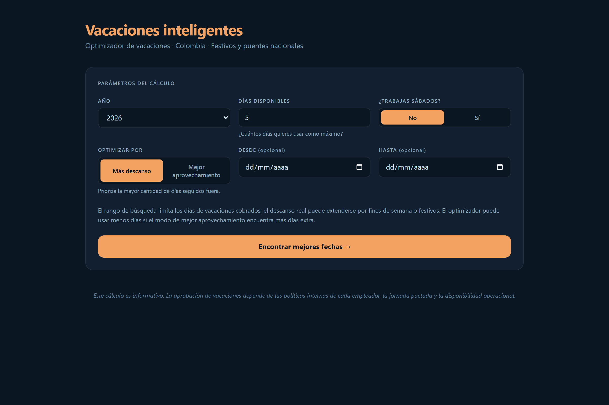
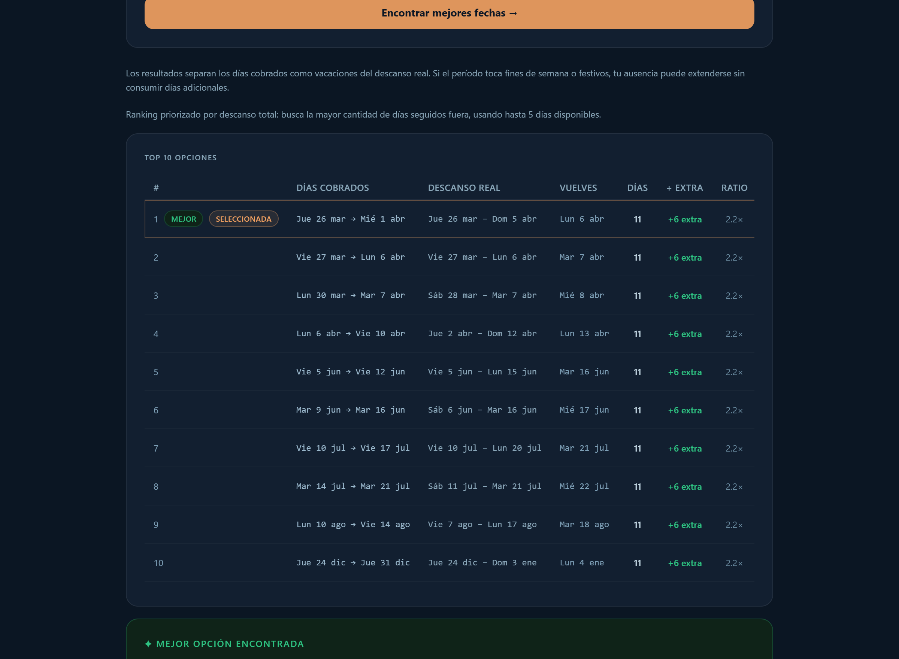

# Vacaciones Inteligentes · Colombia

[](https://github.com/NastMz/vacaciones-inteligentes/actions/workflows/ci.yml)


**Plan your time off around Colombian holidays and get the most rest out of every vacation day.**

Tell the app how many vacation days you have, and it finds the date ranges where weekends and national holidays (*festivos* and *puentes*) stretch them into the longest possible break.

**Live demo → [vacaciones-inteligentes.vercel.app](https://vacaciones-inteligentes.vercel.app)**





> The UI is in Spanish because it targets workers in Colombia.

## Features

- **Top 10 recommendations** for any year, ranked by one of two strategies:
  - **Max total rest** — the longest continuous break using up to *N* vacation days.
  - **Best efficiency** — the most extra days gained per vacation day, even if that means using fewer days than you have.
- **Charged days vs. real rest** — clearly separates the days your employer deducts from the full break, including adjacent weekends and holidays.
- **Day-by-day calendar** for the selected option, labelling each day as charged, holiday, weekend or free extension.
- **Saturday-worker mode** for people whose work week includes Saturdays.
- **Optional search window** to limit results to a date range.
- **Fully client-side** — no backend, no accounts, no data leaves the browser.

## How it works

### Colombian holidays

Holidays are computed for any year, following Colombian law:

| Type | Holidays |
| --- | --- |
| Fixed | New Year, Labour Day, Independence Day, Battle of Boyacá, Immaculate Conception, Christmas |
| Emiliani Law (moved to the next Monday) | Epiphany, St. Joseph, Sts. Peter & Paul, Our Lady of the Rosary of Chiquinquirá, Assumption, Columbus Day, All Saints, Independence of Cartagena |
| Holy Week | Maundy Thursday, Good Friday |
| Easter-relative (Emiliani) | Ascension, Corpus Christi, Sacred Heart |

Easter Sunday is derived with the anonymous Gregorian algorithm, and every Easter-relative date is computed from it.

### Optimizer

A brute-force search over every day of the year. Each working day is tried as a start date: the optimizer consumes exactly *N* working days, then extends the block with the weekends and holidays on either side. Results are deduplicated by their real rest window and ranked by the selected strategy. Complexity is `O(365 × N)`, which runs instantly in the browser.

The domain logic in [`src/domain`](src/domain) is pure TypeScript with no framework dependencies and is covered by unit tests.

## Tech stack

- [Next.js 15](https://nextjs.org/) (App Router, statically prerendered)
- [React 18](https://react.dev/)
- [TypeScript](https://www.typescriptlang.org/) in strict mode
- [Tailwind CSS 3](https://tailwindcss.com/)
- [Vitest](https://vitest.dev/) for unit tests
- Deployed on [Vercel](https://vercel.com/)

## Project structure

```text
src/
├── app/                 # Next.js App Router (page, layout, icon, Open Graph image)
├── components/          # Form, ranking table, best-option card, calendar
├── domain/              # Pure business logic + tests
│   ├── colombian-holidays.ts
│   ├── business-day.ts
│   └── vacation-optimizer.ts
├── lib/formatters.ts    # Date formatting helpers
└── types/               # Shared types
```

## Getting started

Requires Node.js 22+ and [pnpm](https://pnpm.io/).

```bash
pnpm install
pnpm dev        # http://localhost:3000
```

| Script | Description |
| --- | --- |
| `pnpm dev` | Start the development server |
| `pnpm build` | Production build |
| `pnpm start` | Serve the production build |
| `pnpm lint` | Run ESLint |
| `pnpm test` | Run the unit tests once |
| `pnpm test:watch` | Run tests in watch mode |

## Roadmap

- Export a ready-to-send message for HR
- Compare several blocks side by side
- Split vacation days across multiple trips and exclude seasons
- Google Calendar export

## Disclaimer

Results are informational. Vacation approval depends on each employer's policies, the agreed work schedule and operational needs.
